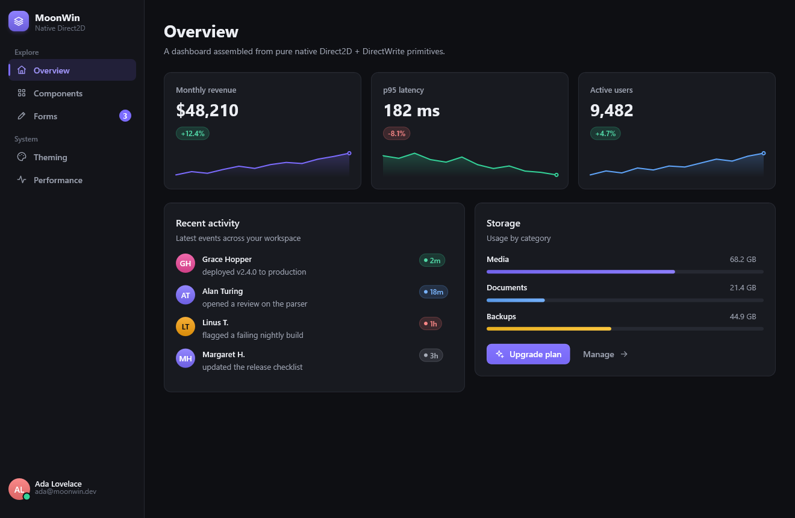
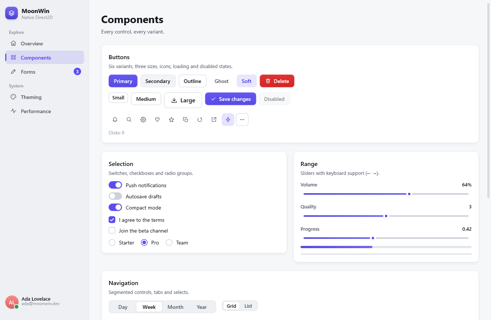
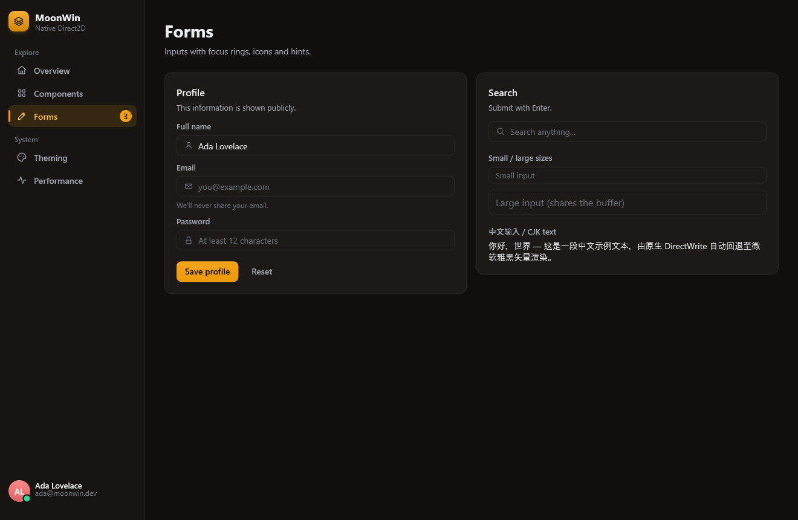
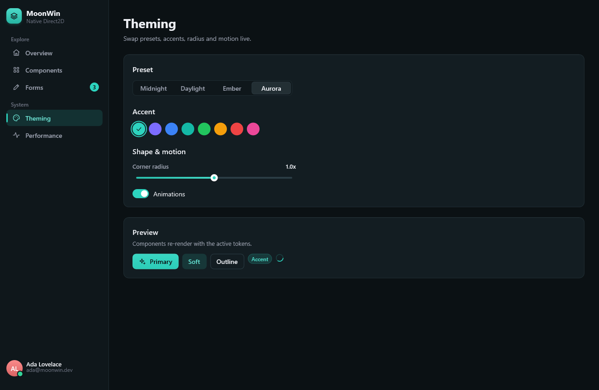
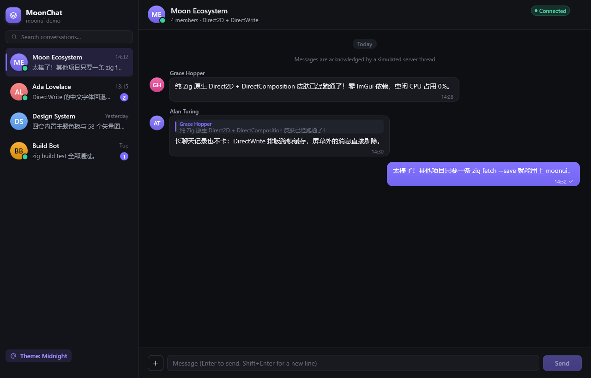

# MoonUI

An immediate-mode native Windows UI library written in pure Zig.
It renders through Win32, Direct3D 11, DXGI, DirectComposition, Direct2D 1.1 and DirectWrite.
There is no Dear ImGui and no C or C++ code. When nothing is animating, the loop sleeps in `MsgWaitForMultipleObjectsEx` and uses about 0% CPU.



| | |
| --- | --- |
|  |  |
|  |  |

## Requirements

- Windows 10 or 11
- Zig **0.17.1**

## Quick start

```powershell
git clone https://github.com/HinaKalo/moonui
cd moonui
zig build run                                   # five-page component gallery
zig build run -- --page components --theme 1    # pages: overview components forms theming performance, themes 0..3
zig build chat                                  # IM demo
zig build test
```

### Start a new app

```powershell
zig build new -- ..\my-app --name my-app
cd ..\my-app
zig build run
```

The generated project depends on this checkout through a relative path, so it builds offline.

### Add to an existing project

```powershell
zig fetch --save=moonui git+https://github.com/HinaKalo/moonui
```

```zig
// build.zig
const moonui = b.dependency("moonui", .{ .target = target, .optimize = optimize });
exe.root_module.addImport("moonui", moonui.module("moonui"));
```

The module links the Windows system libraries it needs.

## Example

```zig
const ui = @import("moonui");

const State = struct { count: u32 = 0, dark: bool = true };

pub fn main() !void {
    var state: State = .{};
    try ui.run(.{ .title = "Counter", .width = 960, .height = 640 }, &state, frame);
}

fn frame(s: *State) void {
    ui.beginMain(.{ .max_width = 720 });
    defer ui.endMain();

    ui.pageHeader("Counter", null);
    ui.beginCard("card", .{});
    if (ui.button("Click me", .{ .variant = .primary, .icon = .sparkles })) s.count += 1;
    ui.text(ui.fmt("Clicked {d} times", .{s.count}), .{ .ink = .muted });
    if (ui.toggle("Dark mode", &s.dark))
        ui.setTheme(if (s.dark) ui.themes.midnight else ui.themes.daylight);
    _ = ui.endCard();
}
```

`frame` runs once per rendered frame. Widgets draw immediately and return what happened: `button` returns true on the click frame, `toggle` returns true when the value changed. Your state lives in your own struct.

## What's included

- **Layout**: sidebar with navigation, scrolling main area, cards, equal-width grids, rows, groups, independent scroll areas with stick-to-bottom.
- **Controls**: buttons (six variants, three sizes, icons, loading), icon buttons, toggles, checkboxes, radio groups, sliders, segmented controls, tabs, selects, single-line and growing multi-line text editors, badges, avatars, progress bars, spinners, sparklines, stats, tooltips, menus and context menus, modal dialogs, in-app toasts.
- **Text**: DirectWrite layouts cached across frames, CJK fallback (`font_locale = "zh-cn"` selects Microsoft YaHei), ellipsis truncation, IME candidate window that follows the caret, selection and clipboard shortcuts.
- **Themes**: four presets (Midnight, Daylight, Ember, Aurora); accent, corner radius and motion can be changed at runtime.
- **Icons**: 58 vector icons drawn with Direct2D.
- **Chat widgets**: conversation rows, grouped message bubbles with quotes and delivery status, composer, time dividers.
- **Images**: WIC decode (EXIF-aware, scaled to fit) and encode, Direct2D bitmaps, files dropped from Explorer, clipboard images.
- **Desktop shell**: single instance with argument forwarding, notification-area icon with a menu, taskbar flashing and overlay badges, URL protocol registration, Windows toast notifications for unpackaged apps through WinRT.
- **Testing**: `AppOptions.capture_path` renders headless and writes a BMP; set `MOONUI_TRACE=<file>` to log input events (text content is never written).

## License

[MIT](LICENSE)
